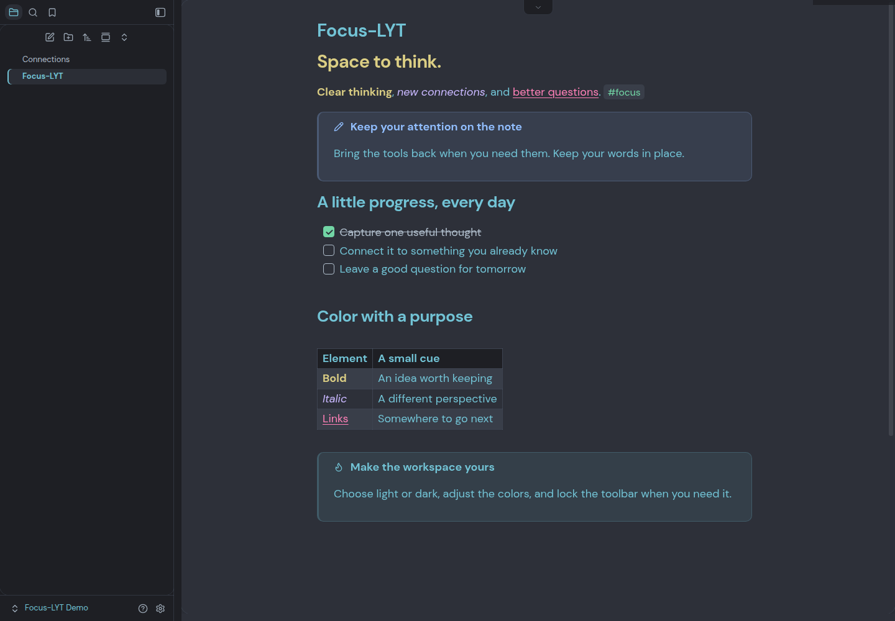
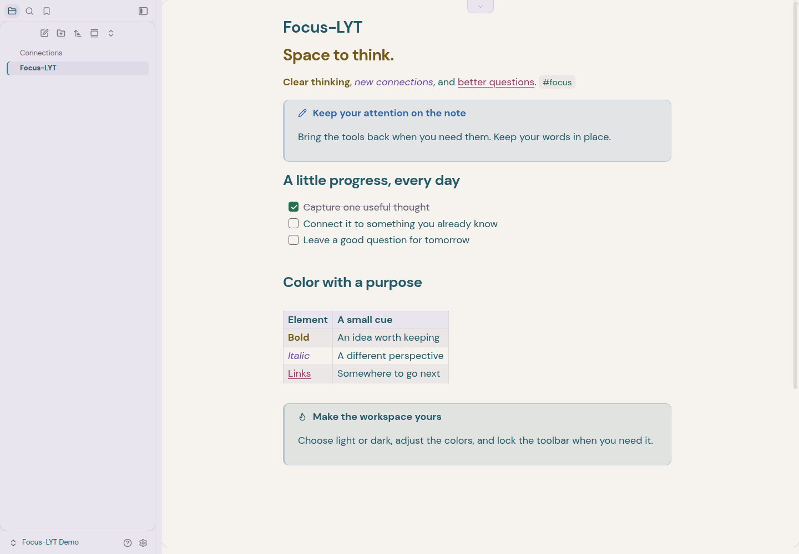
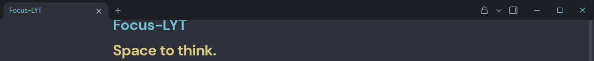
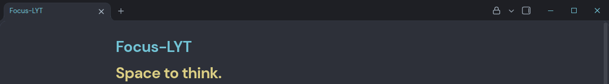

# Focus-LYT

**Raum zum Denken. Farbe für Verbindungen.**

[English](README.md) · [Installation](#installation) · [Fokus-Bedienung](#fokus-bedienung) · [Changelog](CHANGELOG.md)

Ein Obsidian-Theme auf Grundlage der Farben und Typografie von [LYT Mode](https://github.com/nickmilo/LYT-Mode), mit einer von [Border](https://github.com/Akifyss/obsidian-border) inspirierten Oberfläche und automatischen Einblendungen. Focus-LYT verbindet diese Grundlagen mit einem hellen Farbschema und optionalen Bedienelementen, die deine Notiz in den Mittelpunkt stellen.

**Obsidian ab 1.8.10 · Hell & Dunkel · MIT**

[](docs/images/dark.png)

*Dunkel bewahrt die ausdrucksstarken LYT-Farben auf anthrazitfarbenen Flächen. Die Beispielnotiz zeigt Aufgaben, Links, eine Tabelle und Callouts. Die Tableiste ist ausgeblendet; darüber bleibt der optionale Pfeil zum Einblenden sichtbar.*

<details>
<summary><strong>Heller Modus – warme Papierflächen, lavendelfarbene Panels und dunklere Akzente</strong></summary>

[](docs/images/light.png)

*Die helle Palette erhält die Bedeutung der einzelnen Farben und passt sie an einen hellen Arbeitsbereich an.*

</details>

Die Aufnahmen stammen aus echtem Obsidian und zeigen die mitgelieferte [Beispielnotiz](examples/vault/Focus-LYT.md) mit Style Settings und Focus-LYT Controls. Automatisches Ausblenden ist standardmäßig **ausgeschaltet**. Ein Klick öffnet das jeweilige Bild in voller Größe.

## Funktionen

- **Eine vertraute Palette.** Cyan für Fließtext, Gold für Fettdruck, Lavendel für Kursivschrift, Pink für Links und Mint für Tags im dunklen Modus; eigene Farben für den hellen Modus.
- **Eine ruhige Oberfläche.** Eingerahmte Panels, native Obsidian-Symbole und ein klarer Notiztitel ohne dekorative Verläufe oder Symbole.
- **Optionale Fokus-Werkzeuge.** Desktop-Leisten einzeln ausblenden, bei Bedarf einblenden oder gemeinsam anheften.
- **Einheitliche Notizgestaltung.** Leseansicht, Live Preview und Quelltextmodus sowie Aufgaben, Callouts, Tabellen, Code und Properties.
- **Offline-Schriften.** DM Sans und DM Mono sind eingebettet; deine eigenen Obsidian-Schriftarten bleiben verwendbar.
- **Touch berücksichtigen.** Auto-Hide wird auf Mobilgeräten und reinen Touch-Oberflächen ausgesetzt. Die Systemeinstellung für reduzierte Bewegung wird beachtet.

## Installation

Focus-LYT wird derzeit manuell installiert und ist noch nicht im Community-Theme-Verzeichnis von Obsidian gelistet.

1. [Focus-LYT 1.0.0 herunterladen](https://github.com/BleonHys/LYT-Mode-Updated/releases/download/1.0.0/focus-lyt-1.0.0.zip) und entpacken.
2. Den enthaltenen Ordner **Focus-LYT** nach `<Vault>/.obsidian/themes/` kopieren.
3. In Obsidian unter **Einstellungen → Darstellung → Themes** das Theme **Focus-LYT** auswählen. Falls es noch nicht erscheint, Obsidian neu laden.

Danach sollte die Struktur so aussehen:

```text
Dein Vault/
└── .obsidian/
    └── themes/
        └── Focus-LYT/
            ├── theme.css
            ├── manifest.json
            ├── LICENSE
            ├── THIRD-PARTY-NOTICES.md
            └── licenses/
```

Das Theme funktioniert allein. Diese optionalen Ergänzungen bieten weitere Möglichkeiten:

| Bestandteil | Funktion | Bezugsquelle |
| --- | --- | --- |
| Style Settings | Farben, Layout, Schreibfokus, Auto-Hide-Schalter und Befehle zum Anheften | **Style Settings** über Obsidians Community-Plugins installieren; [Projekt](https://github.com/mgmeyers/obsidian-style-settings) |
| Focus-LYT Controls | Sichtbarer Pfeil zum Einblenden und ein Schloss in der Notiz-Tableiste | Im Ordner [`focus-lyt-controls`](focus-lyt-controls) enthalten; benötigt Style Settings |

## Fokus-Bedienung

Das automatische Ausblenden ist optional. Für Pfeil und Schloss aus den folgenden Bildern:

1. **Style Settings** installieren und aktivieren.
2. Den Ordner `focus-lyt-controls` aus dem Release-ZIP nach `<Vault>/.obsidian/plugins/` kopieren. `manifest.json`, `main.js` und `styles.css` müssen direkt darin liegen.
3. Obsidian neu laden und **Focus-LYT Controls** unter **Einstellungen → Community-Plugins** aktivieren.
4. Unter **Style Settings → Focus-LYT → Ein- und Ausblenden** den Schalter **Notiz-Tabs automatisch ausblenden** einschalten.

### 1. Die Notiz bleibt im Blick

[](docs/images/focus-hidden.png)

Der Pfeil zeigt die Auslösefläche. Mit der Maus darüberfahren oder darauf klicken, um die Tableiste zu öffnen. Ohne Begleiterweiterung bleibt die schmale Auslösefläche am oberen Rand verfügbar.

### 2. Werkzeuge bei Bedarf einblenden

[](docs/images/focus-open.png)

Die Tableiste legt sich über die Notiz, ohne deren Text zu verschieben. Während sie geöffnet ist, verschwindet der Pfeil. Die Tabs der Seitenleisten bleiben sichtbar und an ihrer Position.

### 3. Mit einem Klick festsetzen

[](docs/images/focus-locked.png)

Das Schloss hält die Leiste dauerhaft sichtbar. Beim Anheften erhält sie wieder ihren eigenen Platz im Layout; gleichzeitig pausieren **alle sechs** Auto-Hides des Themes. Lösen stellt deine einzelnen Einstellungen wieder her. Auch der Style-Settings-Befehl **Leisten anheften** in der Befehlspalette schaltet diesen Zustand um.

Unter **Einstellungen → Tastenkürzel** kannst du beispielsweise **Strg+Alt+P** dafür vergeben. Das ist ein Vorschlag, kein voreingestelltes Tastenkürzel. Pfeil und Schloss unterstützen außerdem Tastaturfokus, Eingabe- und Leertaste.

Auf Handy und Tablet fügt die Begleiterweiterung keine Bedienelemente hinzu; die native Touch-Navigation bleibt sichtbar.

## Anpassen

Mit aktiviertem Style Settings findest du den Bereich **Focus-LYT**:

| Bereich | Möglichkeiten |
| --- | --- |
| Farben | Hintergründe, Fließtext, Fett, Kursiv, Links und Tags getrennt für Hell und Dunkel |
| Layout | Panel-Abstände und Rundungen oder eine flachere Oberfläche |
| Schreibfokus | Aktuelle Zeile hervorheben oder inaktiven Fließtext abdunkeln, während Syntaxfarben erhalten bleiben |
| Automatisch ausblenden | Notiz-Tabs, Statusleiste, Ribbon, Seitenleisten-Kopf/Suche, Notizkopf und Vault-Profil |
| Handy und Tablet | Optionale Tablet-Panels und volle Breite für Telefon-Seitenleisten |
| Bewegung | Übergänge des Schreibfokus und ein Schalter für reduzierte Bewegung |

Alle Auto-Hides beginnen ausgeschaltet und lassen sich einzeln aktivieren. **Leisten anheften** pausiert sie gemeinsam. Weitere Einzelheiten stehen in der [Theme-Anleitung](docs/GUIDE.de.md).

## Kompatibilität und Rückmeldungen

Die Mindestversion ist **Obsidian 1.8.10**. Focus-LYT wurde mit Obsidian **1.8.10** und **1.14.4** unter Linux und **Style Settings 1.0.9** geprüft, unter anderem mit Bearbeitung, Notizansichten, geteilten Ansichten, Fokus-Bedienelementen, maximierten Fenstern und emulierten Touch-Oberflächen.

Native Fensterknöpfe unter Windows/macOS und echte iOS-/Android-Geräte wurden nicht verifiziert. Andere Community-Plugins können eigene Stilanpassungen benötigen.

Erstelle für Fehler [ein Issue](https://github.com/BleonHys/LYT-Mode-Updated/issues/new/choose) mit Obsidian-, Theme- und Betriebssystemversion, Farbmodus, relevanten Plugins/Einstellungen und Schritten zum Nachstellen. Ein Screenshot mit einer Beispielnotiz hilft besonders.

## Mitwirken

Vorschläge und Verbesserungen sind willkommen; Hinweise stehen unter [Contributing](CONTRIBUTING.md). Der [Beispiel-Vault](examples/README.md) eignet sich zum Vergleichen beider Farbmodi. Veröffentlichung und Einreichung beschreibt [Release and submission](docs/RELEASING.md).

## Danksagung und Lizenz

Focus-LYT ist ein unabhängiges Projekt auf Grundlage zweier Open-Source-Themes:

- **[LYT Mode](https://github.com/nickmilo/LYT-Mode)** von **Nick Milo**, mit Designbeiträgen von **Cecilia May**: Die ursprüngliche Palette, Typografie und mitgelieferten Schriftdateien bilden die gestalterische Grundlage.
- **[Border](https://github.com/Akifyss/obsidian-border)** von **Akifyss**: Panel-Layout und automatisches Einblenden waren die Vorbilder für den Arbeitsbereich.

Danke an beide Projekte. Focus-LYT ist kein offizielles Release dieser Themes.

Theme und Begleiterweiterung stehen unter **MIT**. Für DM Sans und DM Mono gilt weiterhin die **SIL Open Font License 1.1**. Siehe [Theme-Lizenz](LICENSE), [Lizenz der Begleiterweiterung](focus-lyt-controls/LICENSE) und [Drittanbieter-Nachweise](THIRD-PARTY-NOTICES.md).
